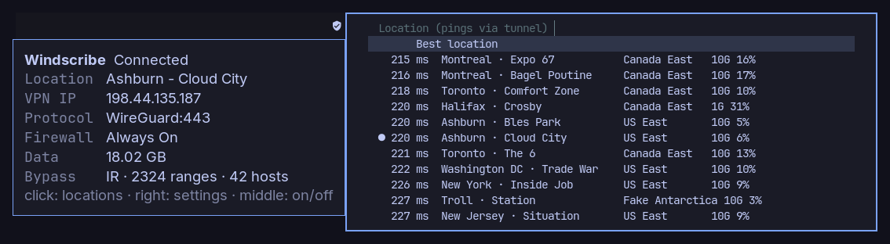

# Windscribe Panel

[](https://github.com/AryanHamedani/windscribe-panel/actions/workflows/test.yml)
[](https://github.com/AryanHamedani/windscribe-panel/releases)
[](LICENSE)

Windscribe VPN in your Linux desktop bar. One icon tells you whether you are
protected; one click picks a location, fastest first; and split tunneling
keeps a whole country's networks out of the tunnel, refreshed every week.



Built for using Windscribe from Iran, where local sites refuse foreign IPs
and foreign sites are filtered locally, so you need both at once. It works the
same for any country.

- **Status at a glance.** Distinct icons for connected, connecting, off with
  the firewall holding, and off *without* it, the one state where your
  traffic leaves unprotected.
- **Locations by ping.** Every server with its latency, link speed and load,
  fastest first.
- **Censorship tools.** Protocol (WireGuard, Stealth, WStunnel, UDP, TCP),
  Windscribe's censorship circumvention and its AmneziaWG presets.
- **Country split tunneling.** All of a country's IP ranges bypass the VPN,
  plus up to 50 hostnames of your own.
- **Safe by default.** Disconnecting asks first and says what happens to
  your traffic. Nothing runs as root; settings are written atomically.

> Unofficial. Not affiliated with or endorsed by Windscribe.

## Where it runs

It is one program, `windscribe-panel`, with two front ends on top:

| Desktop | Front end | What you get |
|---|---|---|
| **Waybar**, on Hyprland, Sway, niri, river or any wlroots compositor | `waybar/` module | Icon with a status tooltip; click for locations, right-click for settings, middle-click to connect or disconnect. Menus open in fuzzel, wofi, rofi, tofi or bemenu. |
| **Omarchy** | `omarchy/` shell panel | A native popup in the Omarchy bar, matching its Network panel. |
| **Any other bar** | `windscribe-panel waybar` | Most bars can run a command and show its JSON output (Waybar's format); bind the menu commands to keys. |

The Linux side needs systemd and one of pacman, apt, dnf or zypper; Windscribe
publishes its CLI for Arch, Debian/Ubuntu, Fedora and openSUSE.


## Install

```bash
curl -fsSL https://raw.githubusercontent.com/AryanHamedani/windscribe-panel/main/install.sh | bash
```

Run the same command to update. It:

1. installs what is missing: `python3`, `ping`, `jq`, `curl`, a menu
   launcher (fuzzel) if you have none, and **`windscribe-cli`** itself, the
   official package from
   [Windscribe's GitHub releases](https://github.com/Windscribe/Desktop-App/releases),
   checked against its published sha256,
2. installs the front end for your desktop: the Omarchy panel on Omarchy,
   otherwise the command into `~/.local/bin` and the Waybar module into
   `~/.config/waybar/`,
3. starts Windscribe's services and signs you in if needed,
4. turns split tunneling on, in Exclude mode, and fetches Iran's ranges
   (`… | bash -s -- DE` for another country),
5. installs `windscribe-split-refresh.timer` to refresh them weekly,
6. if Tailscale is installed, keeps it working beside Windscribe and its
   firewall (see [Tailscale](#tailscale)).

It asks for your password for the package manager and your Windscribe
sign-in, nothing else. `--waybar` picks the Waybar front end even on Omarchy.

**Waybar** needs two lines in your config, which the installer prints rather
than editing a file you wrote by hand:

```jsonc
"include": ["~/.config/waybar/windscribe-panel.jsonc"],
"modules-right": ["custom/windscribe", "network", "clock"],
```

and `@import "windscribe-panel.css";` at the top of `style.css`.

## Use

| Waybar | Omarchy | Does |
|---|---|---|
| Click | Click | Locations, fastest first |
| Right-click | Click, then **Connection** or **Split tunneling** | Settings |
| Middle-click | Middle-click | Connect, or disconnect after asking |
| Hover | Click | Location, VPN IP, protocol, firewall, data, bypass |

The same actions from a terminal or a key binding:

```bash
windscribe-panel menu       # pick a location
windscribe-panel settings   # protocol, censorship, LAN, split tunneling
windscribe-panel toggle     # connect, or disconnect after asking
windscribe-panel waybar     # the status as Waybar JSON
```

```ini
# Hyprland
bind = SUPER ALT, V, exec, windscribe-panel menu
# Sway
bindsym $mod+Mod1+v exec windscribe-panel menu
```

On Omarchy, `omarchy shell io.github.aryanhamedani.windscribe toggle` opens the
panel; `connect`, `disconnect` and `view settings|bypass` work too.

## Configure

| Setting | Where | Default | Meaning |
|---|---|---|---|
| `WINDSCRIBE_PANEL_MENU` | environment | first of fuzzel, wofi, rofi, tofi, bemenu | Your own dmenu-style command, e.g. `rofi -dmenu -i -p` |
| `WINDSCRIBE_PANEL_SIGNAL` | environment | `8` | Signal that refreshes the Waybar module; match `"signal"` in the module |
| `WINDSCRIBE_BYPASS_COUNTRY` | environment | the last country fetched | Country the settings menu refreshes |
| icons, colors | `windscribe-panel.jsonc`, `windscribe-panel.css` | Nerd Font shields | Per state: `connected`, `connecting`, `off`, `unprotected`, `signedOut`, `unknown` |
| `pinnedRegions` | Omarchy `shell.json` entry | `[]` | Regions listed first when sorting by region (`"US"` pins all three US regions) |
| `sortBy` | Omarchy `shell.json` entry | `"ping"` | `"ping"` or `"region"` |
| `bypassCountry` | Omarchy `shell.json` entry | the last country fetched | Country the panel's refresh button fetches |

Everything else (protocol, firewall, presets) is Windscribe's own config,
`~/.config/Windscribe/windscribe_cli.conf`, which the menus edit for you.

## Ping, speed and load

Speed (link capacity) and load come from the public server list the Windscribe
apps themselves download. Ping is measured here: two ICMP probes to each
location's ping address, all in parallel, about five seconds for the whole
list, cached for 15 minutes.

While connected, every probe also crosses the tunnel, so the times include
the hop to your server and rank locations by their distance from *it*. Both
front ends say so, and a measurement taken while disconnected is kept for a
day in preference to a fresh tunnelled one. For direct times, disconnect once
and open the list.

## Split tunneling

Windscribe's Exclude mode sends listed destinations around the tunnel.
`windscribe-split-refresh` fills that list with every range RIPEstat records
for the country, IPv4 and IPv6, collapsed (about 2,300 entries for Iran;
Windscribe takes up to 4,096). It refuses anything that looks wrong: private
or reserved space, a block wider than /8, an empty answer.

What it keeps:

- Hostnames you added, in a menu or by hand.
- IP ranges you added by hand. It remembers which ranges it wrote last
  (`~/.local/state/windscribe-panel/country-ranges.json`) and only replaces
  those.
- Every other line of the config, byte for byte. The previous file is kept at
  `windscribe_cli.conf.bak`.

```bash
windscribe-split-refresh --dry-run                # fetch and check, write nothing
journalctl --user -u windscribe-split-refresh     # what the timer did
```

**DNS is separate.** Windscribe's R.O.B.E.R.T. filters DNS for every site,
bypassed or not. If a bypassed site resolves to `0.0.0.0`, allow it in your
[R.O.B.E.R.T. rules](https://windscribe.com/myaccount#robertrules).

### Tailscale

With Windscribe's firewall on, tailnet traffic is dropped: it is neither the
tunnel nor the LAN. Both VPNs also use `100.64.0.0/10`, and Windscribe's
routing rules come first, so even a bypassed tailnet address goes to your
router instead of `tailscale0`. When `tailscale` is installed:

- `windscribe-split-refresh` always keeps `100.64.0.0/10` and
  `fd7a:115c:a1e0::/48` in the route list, which opens the firewall to them;
- `bin/setup` adds `/etc/systemd/system/tailscaled.service.d/50-windscribe-panel.conf`,
  which adds `ip rule to 100.64.0.0/10 lookup 52 priority 5200` (and the IPv6
  one) whenever tailscaled starts, ahead of Windscribe's rules, and removes it
  when tailscaled stops.

Installed Tailscale after Windscribe Panel? Run `bin/setup` again.
MagicDNS names don't resolve while Windscribe is connected (it blocks other
DNS servers to prevent leaks); use the `100.x` addresses.

## Troubleshooting

| Symptom | Fix |
|---|---|
| Icon shows *Unavailable* | `systemctl --user status windscribe.service`; the CLI needs its service |
| *Signed out* | `windscribe-cli login` |
| Waybar icon never changes after a click | The module's `"signal"` must match `WINDSCRIBE_PANEL_SIGNAL` (8) |
| Menus do not open | Install fuzzel, wofi, rofi, tofi or bemenu, or set `WINDSCRIBE_PANEL_MENU` |
| Every ping reads `--` | ICMP is blocked on your network; the list falls back to region order |
| A local site still goes through the VPN | It is hosted abroad: add its hostname to the bypass |
| No internet after disconnecting | The firewall is doing its job; connect again, or `windscribe-cli firewall off` |

## Uninstall

```bash
~/.local/share/windscribe-panel/bin/setup --uninstall   # or the Omarchy plugin folder; also drops the Tailscale rule
rm -rf ~/.local/share/windscribe-panel ~/.local/bin/windscribe-panel ~/.local/bin/windscribe-split-refresh \
       ~/.config/waybar/windscribe-panel.{jsonc,css}
# Omarchy: omarchy plugin remove io.github.aryanhamedani.windscribe --yes
```

Windscribe and its settings are left as they are; your package manager
removes `windscribe-cli`.

## Contributing

```
bin/windscribe-panel          the program: windscribe-cli calls, config edits,
                              pings, Waybar output, launcher menus, JSON API
bin/windscribe-split-refresh  country ranges -> split tunnel route list
bin/setup                     dependencies, Windscribe setup, weekly timer
install.sh                    one-command install / update
waybar/                       Waybar module and style
omarchy/                      Omarchy shell panel (QML); manifest.json is its entry
tests/                        unit tests, no network or Windscribe needed
```

Everything that touches Windscribe lives in `bin/windscribe-panel`: it only
runs `windscribe-cli` with fixed arguments and whitelisted settings, and every
config write takes a lock shared with the refresher and replaces the file
atomically. A front end only draws and sends intents, so adding one for
another bar or shell means calling the JSON API:

```bash
windscribe-panel status | jq      # state, settings, bypass
windscribe-panel catalog | jq     # locations with speed and load
windscribe-panel pings | jq       # latency per location
windscribe-panel connect best     # connect, disconnect, set, preset, domain, refresh-ranges
```

```bash
python3 -m unittest discover -s tests
```

If a new Windscribe CLI prints something the parsers do not expect, add the
output to `tests/` first. Pull requests welcome.

## License

MIT. Windscribe and its logo are trademarks of Windscribe Limited.
