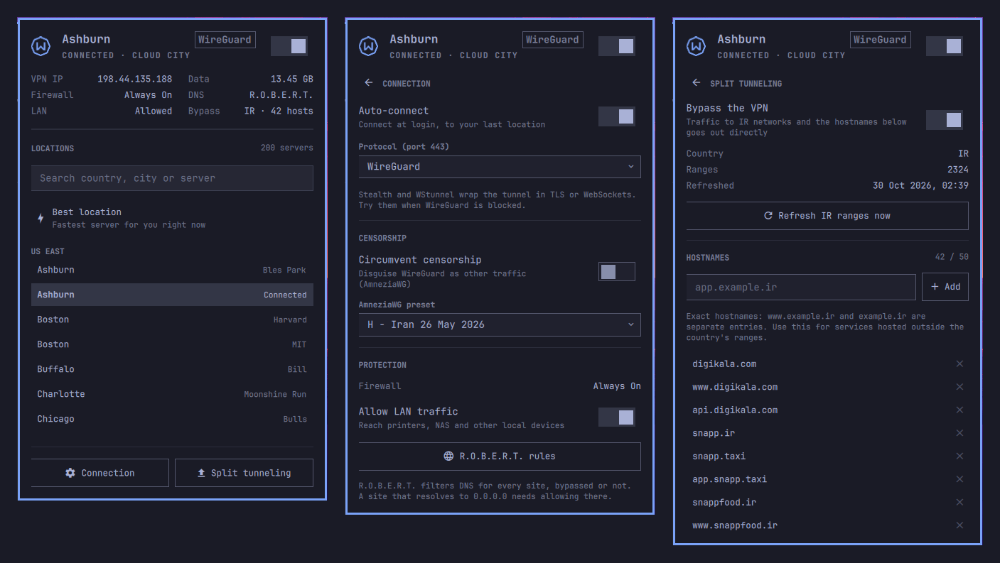

# Windscribe for Omarchy

[](https://github.com/AryanHamedani/omarchy-windscribe/actions/workflows/test.yml)

Windscribe VPN in the [Omarchy](https://omarchy.org) bar. One icon tells you
whether you are protected; one click gets you a location, the connection
settings, and split tunneling that keeps a whole country's networks out of
the tunnel.



Built for using Windscribe from Iran, where local sites block foreign IPs and
foreign sites are blocked locally, so you want both at once. It works the same
for any country.

- **Bar icon**: plain when connected, pulsing while connecting, struck through
  when off, and in the urgent color when off *without* the firewall, the one
  state where traffic is leaving unprotected.
- **Overview**: location, VPN IP (click to copy), data used, firewall, DNS,
  LAN and bypass state, the same stat grid as Omarchy's Network panel.
- **Locations**: all servers grouped by region, searchable, with your current
  region on top. Type, use `↑` `↓`, press `Enter` to connect.
- **Connection**: auto-connect, protocol (Auto, WireGuard, Stealth, WStunnel,
  UDP, TCP), censorship circumvention with AmneziaWG presets, LAN traffic.
- **Split tunneling**: every IP range allocated to a country, refreshed
  weekly from RIPEstat, plus up to 50 hostnames of your own.
- **Safe disconnect**: asks first, and tells you whether the firewall will
  block the internet or your traffic will go out bare.

The panel only talks to `windscribe-cli` and its config file. No daemon of its
own, no root, no network access except the weekly RIPEstat fetch.

> Unofficial. Not affiliated with or endorsed by Windscribe.

## Requirements

- Omarchy 4 (its Quickshell bar and plugin system)
- The Windscribe CLI 2.24 or later, signed in
- `python3` (Omarchy ships it)

Install the CLI from Windscribe's own Arch package, which is kept current
(the AUR's `windscribe-cli-v2-bin` lags behind):

1. Download **Linux → Arch → CLI** from <https://windscribe.com/download>.
2. `sudo pacman -U ~/Downloads/windscribe-cli_*.pkg.tar.zst`
3. `windscribe-cli login`

## Install

```bash
omarchy plugin add https://github.com/AryanHamedani/omarchy-windscribe --enable
~/.config/omarchy/plugins/io.github.aryanhamedani.windscribe/bin/setup
```

`omarchy plugin add` asks which bar section to use; right, beside Network,
is the natural spot. `bin/setup` then:

1. checks `windscribe-cli` and starts `windscribe.service`,
2. signs you in if needed,
3. turns split tunneling on in Exclude mode,
4. fetches Iran's ranges (or pass a country: `bin/setup DE`),
5. installs `omarchy-windscribe-refresh.timer` to refresh them weekly.

Run it again any time; it only changes what is not already right.

## Use

| Action                     | Does                                     |
|----------------------------|------------------------------------------|
| Left click                 | Open or close the panel                  |
| Middle click               | Connect or disconnect                    |
| Type in the panel          | Search locations                         |
| `↑` `↓`, `Enter`           | Pick a location and connect              |
| `Enter` with an empty search | Connect to the best location           |
| `Esc`                      | Clear the search, go back, or close      |

From a keybinding or a script:

```bash
omarchy shell io.github.aryanhamedani.windscribe toggle      # the panel
omarchy shell io.github.aryanhamedani.windscribe connect     # last location
omarchy shell io.github.aryanhamedani.windscribe disconnect
omarchy shell io.github.aryanhamedani.windscribe view bypass # main | settings | bypass
```

For example, in `~/.config/hypr/bindings.conf`:

```
bindd = SUPER ALT, V, Windscribe, exec, omarchy shell io.github.aryanhamedani.windscribe toggle
```

## Configure

Settings go on the widget's entry in `~/.config/omarchy/shell.json`:

```json
{ "id": "io.github.aryanhamedani.windscribe", "pinnedRegions": ["US", "Germany"], "bypassCountry": "IR" }
```

| Setting         | Default | Meaning                                                        |
|-----------------|---------|----------------------------------------------------------------|
| `pinnedRegions` | `[]`    | Regions listed first. Prefixes: `"US"` pins US East, Central and West |
| `bypassCountry` | `"IR"`  | Country the panel's refresh button fetches. Match it to `bin/setup` |

Everything else (protocol, firewall, presets) lives in Windscribe's own config,
`~/.config/Windscribe/windscribe_cli.conf`, which the panel edits for you.

## How split tunneling works here

Windscribe's Exclude mode sends listed destinations around the tunnel.
`bin/windscribe-split-refresh` fills that list with every range RIPEstat
records for the country, IPv4 and IPv6, collapsed (about 2,300 entries for
Iran; Windscribe takes up to 4,096). It refuses anything that looks wrong:
private or reserved space, a block wider than /8, an empty answer.

What it keeps:

- Hostnames you added, in the panel or by hand.
- IP ranges you added by hand. It remembers which ranges it wrote last
  (`~/.local/state/omarchy-windscribe/country-ranges.json`) and only replaces
  those.
- Every other line of the config, byte for byte. A copy of the previous file
  is left at `windscribe_cli.conf.bak`.

```bash
bin/windscribe-split-refresh --dry-run   # fetch and check, write nothing
journalctl --user -u omarchy-windscribe-refresh   # what the timer did
```

**DNS is separate.** Windscribe's R.O.B.E.R.T. filters DNS for every site,
bypassed or not. If a bypassed site resolves to `0.0.0.0`, allow it in your
[R.O.B.E.R.T. rules](https://windscribe.com/myaccount#robertrules); the
Connection page links there.

## Troubleshooting

| Symptom | Fix |
|---|---|
| Icon struck through, panel says *Unavailable* | `systemctl --user status windscribe.service`; the CLI needs its service |
| *Signed out* | Click **Sign in**, or run `windscribe-cli login` |
| A local site still goes through the VPN | It is hosted abroad: add its hostname on the Split tunneling page |
| A local site does not load at all | Check R.O.B.E.R.T., then try another protocol (Stealth works on most filtered networks) |
| No internet after disconnecting | That is the firewall doing its job; connect again, or turn it off with `windscribe-cli firewall off` |

## Uninstall

```bash
~/.config/omarchy/plugins/io.github.aryanhamedani.windscribe/bin/setup --uninstall
omarchy plugin remove io.github.aryanhamedani.windscribe --yes
```

Windscribe itself and its settings are left as they are.

## Development

```
Panel.qml                     the bar icon and popup (Quickshell / QML)
backend.py                    JSON adapter: windscribe-cli calls, config edits
bin/windscribe-split-refresh  country ranges -> split tunnel route list
bin/setup                     install / uninstall the weekly refresh
tests/test_backend.py         parsers, validation, atomic writes
```

The panel never runs anything but `backend.py`, and `backend.py` only ever
runs `windscribe-cli` with fixed arguments and whitelisted settings, so a bad
click cannot write arbitrary values into the config. Every config write takes
a lock shared with the refresher and replaces the file atomically.

Hack on a clone in place of the installed copy; the shell reloads a plugin
when its files change:

```bash
git clone https://github.com/AryanHamedani/omarchy-windscribe ~/.config/omarchy/plugins/io.github.aryanhamedani.windscribe
python3 -m unittest discover -s tests       # tests
python3 backend.py status | jq              # what the panel sees
omarchy shell io.github.aryanhamedani.windscribe inspect
journalctl --user -f | grep windscribe      # QML errors
```

If a new CLI version prints something the parsers do not expect, add the
output to `tests/test_backend.py` first. Pull requests welcome.

## License

MIT. Windscribe and its logo are trademarks of Windscribe Limited.
